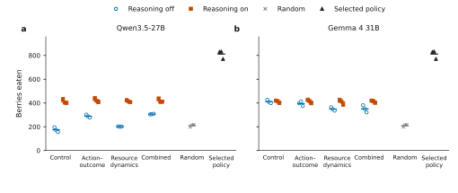
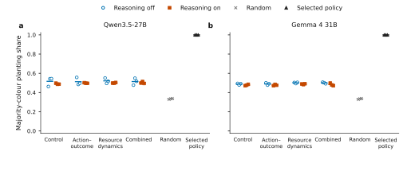
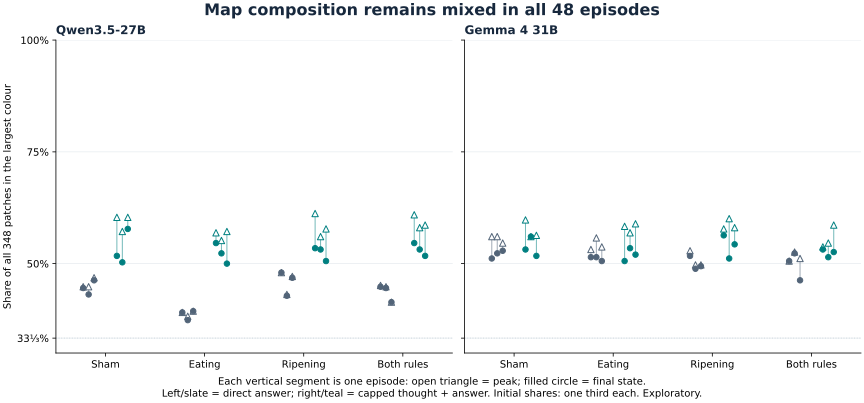

# Decision support and collective coordination in LLM populations

*Draft paper, revised 11 November 2026. Task-relevant information and deliberation under preference conflict.*

## Abstract

Providing agents with information about action consequences and an opportunity to deliberate may change how they act, but whether such decision support also facilitates coordination under conflicting preferences is a separate question. We ask how each form of support affects task performance and collective coordination in LLM populations. We investigate these questions in *Allelopathic Harvest*, where sixteen players share berry patches but have different colour preferences. We vary rule information and whether the model generates a thought capped at 1,024 tokens before answering. Across two models, four prompt conditions, two generation conditions and three independent episodes per cell, the capped-reasoning condition increases mean episode harvest by 174.3 berries for Qwen and 35.2 for Gemma. Rule-information effects differ between models. Yet 99.68–100% of planting attempts remain aligned with private taste. An exploratory reconstruction, validated against 72,000 logged majority snapshots, shows that no colour occupies more than 61.2% of patches. Concentration increases in some conditions, while maps remain mixed. This case illustrates why evaluating decision support requires distinguishing task performance from collective organisation. It does not establish a general effect on coordination or identify the cognitive cause of the observed behaviour.

## 1. Research problem and questions

### 1.1 Decision support under preference conflict

An agent can have useful information about its actions and time to consider its next decision while still facing a coordination problem. Its outcome may depend on choices made by other agents, and those agents may prefer a different joint outcome. Improving the information available to each decision-maker does not by itself settle how their choices will fit together.

Consider a scheduling problem in which different agents prefer different meeting times. Explaining the consequences of available choices may help each agent evaluate its options. Allowing further deliberation may change its preferred plan. Neither intervention necessarily produces a compatible schedule. This is a conceptual example, not an application evaluated in this study.

The distinction is between difficulties in evaluating a choice and difficulties in fitting several choices together. An agent may lack relevant information or fail to consider an action's consequences. Agents can also disagree over which joint outcome to pursue, even when consequences are understood. Providing information or further deliberation addresses the conditions of individual choice without necessarily changing those preferences. Whether it also reorganises interaction is therefore an empirical question, not a consequence of calling an intervention helpful.

We use **decision support** to mean two interventions intended to assist choice: task-relevant information about action consequences, and an opportunity to generate intermediate reasoning before acting. Calling them support does not assume that they improve decisions. Either can help, have little effect, or induce unproductive behaviour.

**Preference conflict** means that agents rank possible outcomes differently. **Collective coordination** concerns how interdependent choices become compatible and organised over time despite those differences. Coordination can involve complementary roles or turn-taking; it need not mean everyone takes the same action. A common convention is one possible form of organisation, not a universal definition of coordination. **Task performance** concerns effectiveness on a task-specific outcome and must be evaluated separately.

This problem connects to research on social dilemmas, where individually attractive choices can be in tension with outcomes that depend on collective action. In sequential environments, cooperation is expressed through policies over time, rather than necessarily through a single action labelled “cooperate.” These ideas motivate studying individual decision support together with collective behaviour; they do not make support, performance, coordination and cooperation interchangeable. [Dawes (1980)](https://doi.org/10.1146/annurev.ps.31.020180.001125); [Leibo et al. (2017)](https://arxiv.org/abs/1702.03037).

### 1.2 Research questions

The organising question is **how support for individual decision-making relates to collective coordination when agents have conflicting preferences**. Two research questions specify the interventions:

**RQ1 — Task-relevant information. How does task-relevant rule information affect performance and coordination among LLM agents with conflicting preferences?**

**RQ2 — Reasoning. How does the opportunity to reason before acting affect performance and coordination?**

Both questions allow beneficial, harmful or negligible changes. Comparing their performance and collective-behaviour components lets us examine whether an intervention's task benefit is accompanied by more coordinated organisation. This relationship is the common thread across the two questions, rather than an additional research question derived from a particular observed result.

### 1.3 What this study can answer

We investigate the questions in one controlled environment. The performance components retain the original confirmatory tests. Coordination is examined using a pre-specified secondary cooperation proxy and additional exploratory descriptions of behaviour and environmental organisation. None is retrospectively promoted to a confirmatory primary outcome. Preference conflict is fixed, so the study does not estimate the effect of introducing conflict or compare conflicting with aligned preferences.

The game below supplies a concrete instance of the conceptual problem and measurable indicators. It does not define the general problem. Findings establish what the two decision-support interventions do in this implementation, rather than a general law about LLM coordination or isolated individual competence.

## 2. Using a game to investigate the questions

*Allelopathic Harvest* is an experimental setting in which the concepts above can be made observable. It has interdependent actions, different preferences over outcomes and an environment that records the cumulative consequences of those actions. The following mapping connects the general questions to this particular study.

| General concept | Implementation in this study | What the implementation does not establish |
|---|---|---|
| Task-relevant information | Added sentences about action execution and environmental consequences | Whether players understand or believe the information |
| Opportunity to deliberate | A capped thought followed by an action answer | Unrestricted planning or an isolated change in cognitive competence |
| Preference conflict | Two groups prefer different outcome colours | The causal effect of conflict, since preferences are not varied |
| Task performance | Total berries consumed per episode | An isolated player's ability or improvement for every player |
| Collective coordination | Observed planting alignment, overwriting and map composition | A general coordination score, shared intent or the optimal joint policy |

These are operational choices for studying the research questions. A different scenario could use different actions and outcomes while retaining the same questions about information, deliberation and coordination.

### 2.1 Private tastes and a shared production process

Sixteen players move through 348 berry patches. Eight prefer red berries and eight prefer green; blue berries have no preferring group. Eating a preferred-colour berry gives two reward units, while eating another colour gives one. Consumption occurs by stepping onto a ripe berry and leaves an unripe patch of the same colour.

Players can also plant. Here, planting means recolouring an existing unripe patch with a directional beam; it does not create another patch or immediately provide a berry. A colour's eligible patches have a higher probability of ripening when more patches on the map share that colour. Successful recolouring restarts the patch's minimum ripening wait. Movement, planting opportunities and the timing of recolouring therefore all affect what can eventually be harvested.

The production rule creates a reason to consider the population's colour choices jointly. The private rewards create disagreement about which colour would be preferable. A red-preferring player that plants red may replace a green patch, which a green-preferring player can later replace again. Such behaviour can be observed without assuming that either player recognises a conflict or intends to frustrate the other.

The task belongs to the convention-formation setting developed by [Köster et al. (2020)](https://arxiv.org/abs/2010.09054). In this implementation, a proposed shared-colour policy is a counterfactual: we have not measured its realised harvest or welfare against the observed policies. Faster ripening of one colour is a game rule, not a guarantee of a particular group-level performance gain.

### 2.2 What coordination would mean here

Three concepts should remain distinct. **Harvesting performance** is the number of berries consumed in an episode. **Preference alignment** describes whether players plant their private preferred colour. **Map concentration** describes how much of the resource has one colour. A shared planting convention would concern a sustained population-level pattern, potentially requiring some players to plant a colour they do not privately prefer.

None of these observations alone reveals intent. A concentrated map could arise from unequal activity rather than agreement, and increased harvest could arise from more effective movement rather than a shared planting policy. The paper therefore describes planting and map composition directly. It does not infer cooperation merely from higher reward or from a colour being slightly ahead.

### 2.3 How a language model becomes a player

At each frame, the model receives the rules, the assigned rule-information sentence, its player's private taste, a textual description of visible patches and avatars, and ten frames of its own actions and observed events. The local view is partial. Public avatar colour is not a reliable label of another player's taste, and the players do not receive a global map summary or a channel for sending messages.

The model returns an action from a shuffled list of eleven names. An unreadable response gets one stricter retry and then becomes a no-op. Once all players have answered, their actions enter one joint simulator step. New local observations and visible events form the next contexts. Weights remain fixed: players can respond to recent context, but they do not receive parameter updates or accumulate training across episodes. Logged thoughts and periodic notes are excluded from subsequent memory.

*Figure 1. Study overview. The robots and plants are illustrative. Experimental conditions remain fixed within an episode; feedback updates local observations and memory. The implementation has no inter-player messaging.*

## 3. Related work and the specific contribution

**Sequential interaction and the task's origin.** Leibo and colleagues distinguish temporally extended policies from atomic cooperate/defect choices. Melting Pot subsequently provides environments for studying interdependent agents and social generalisation. Our experiment uses one substrate rather than the full benchmark's held-out-partner evaluation protocol. [Leibo et al. (2017)](https://arxiv.org/abs/1702.03037); [Leibo et al. (2021)](https://proceedings.mlr.press/v139/leibo21a.html); [Agapiou et al. (2023 version)](https://arxiv.org/abs/2211.13746).

The closest task-level predecessor is Köster and colleagues' study of heterogeneous preferences and convention formation using model-free reinforcement learning. Their agents can establish and switch conventions, including behaviour that departs from a subgroup's preferred outcome. Our study examines frozen language-model policies acting through text contexts. Differences in training, information and evaluation prevent a direct ranking of the two approaches. Their work motivates the question; it is not a baseline reproduced here. [Köster et al. (2020)](https://arxiv.org/abs/2010.09054).

**Cooperation and conventions in language-model populations.** Mosquera and colleagues adapt Melting Pot's *Commons Harvest* to LLM-augmented agents with memory and additional cognitive modules. That establishes a close connection between language-mediated action and shared-resource evaluation, but their task and agent architecture differ from ours. [Mosquera et al. (2024)](https://arxiv.org/abs/2403.11381).

GovSim studies societies managing a renewable common resource. It includes communication and examines both that channel and a reasoning intervention based on considering what would happen if everyone acted similarly. Our study has neither a discussion phase nor that specific reasoning prompt; it concerns a spatial production-and-preference problem. Its findings should not be treated as a replication or contradiction of GovSim's cooperation results. [Piatti et al. (2024)](https://arxiv.org/abs/2404.16698).

Ashery and colleagues show convention formation in LLM naming games. Agents are rewarded for matching choices, and local interaction can lead to population-wide agreement. That result establishes that LLM conventions can emerge under some conditions. The current task adds spatial action, an evolving resource and different tastes over colours; it is not simply another naming game. These differences motivate a bounded account of where convention-like organisation is and is not observed. [Ashery, Aiello and Baronchelli (2025)](https://arxiv.org/abs/2410.08948).

**Reasoning output and explanation.** Chain-of-thought prompting can improve performance on several reasoning tasks, which motivates investigating an intermediate-thought generation condition here. Our treatment uses the models' configured thought generation with a hard cap, rather than reproducing the original few-shot prompting method. Separately, plausible thought text need not faithfully explain a prediction: Turpin and colleagues demonstrate explanations that omit influential input biases. These findings motivate treating our traces as supplementary behavioural text rather than direct access to the cause of action. [Wei et al. (2022)](https://proceedings.neurips.cc/paper/2022/hash/9d5609613524ecf4f15af0f7b31abca4-Abstract.html); [Turpin et al. (2023)](https://proceedings.neurips.cc/paper_files/paper/2023/hash/ed3fea9033a80fea1376299fa7863f4a-Abstract.html).

The contribution is a bounded study of **decision support under preference conflict**: a controlled comparison of rule information and a configured capped-reasoning regime, evaluated through task performance and collective organisation. The game provides the operational setting. We make no claim to be the first study of LLM cooperation or convention formation.

## 4. Operationalising the research questions

The two research questions are organised by intervention, and each has a performance component and a coordination component. Their evidence status differs:

| Research question | Intervention contrast | Performance evidence | Coordination evidence |
|---|---|---|---|
| RQ1: task-relevant information | Both rules versus irrelevant-text sham; individual rule sentences provide secondary contrasts | Original H1 tests on berries eaten, separately for each model | Pre-specified secondary cooperation proxy; exploratory planting and composition comparisons |
| RQ2: opportunity to reason | Capped thought plus answer versus direct answer | Original H2 tests on berries eaten, separately for each model | The same secondary cooperation measure and exploratory collective-behaviour indicators |

H1 and H2 are hypotheses within the performance components of RQ1 and RQ2. They are not confirmatory tests of cooperation. The broader framing and additional map-composition analysis were developed after the initial results; the majority-colour planting measure was already a secondary outcome. The four-test confirmatory family is unchanged.

### 4.1 Experimental design

Four information conditions are crossed with direct answers or a capped thought followed by an answer. The information conditions are an irrelevant-text sham, a sentence explaining how to eat, a sentence explaining the colour-dependent ripening rule, and both sentences together. All other player information is held constant within the block A design. The complete English texts and frozen condition names are in [the prompt file](../configs/prompts_v4.json).

All four conditions already receive the reward objective, ripe-only consumption and +2/+1 rewards, the recolouring rule and beam limits, sanctions, observation conventions and memory/action instructions. The base text does not explicitly state that consumption is triggered by stepping onto the berry or that ripening depends on global colour abundance. The eating and ripening conditions add those respective relationships; both rules adds both; sham adds only provenance text. The manipulation is therefore additional explicit action/environment information, not instructions versus no instructions. The [frozen prompt templates](../configs/prompts_v4.json) make this distinction explicit.

The design is run separately for Qwen3.5-27B and Gemma 4 31B. Each cell has three independent episodes of 1,500 frames, giving 48 episodes. Every player within an episode shares the model and treatment. Seeds label replicates but are not treated as paired worlds across conditions. The language is always English. Model comparisons do not isolate parameter count or any other single architectural feature.

The sham controls for adding irrelevant text at the same location. It has the same word count as the combined-rule condition but is longer than either individual rule sentence. Main episodes use one wording per condition. These comparisons therefore do not isolate semantic meaning from every difference in wording, length or specificity.

The reasoning condition permits a thought of up to 1,024 tokens, closes a thought at the cap and then requests an answer. Approximately 99% of thoughts reach the cap. Qwen changes its configured temperature/top-p from 0.7/0.8 to 1.0/0.95 in that condition; Gemma's settings remain constant. We estimate the effect of each configured generation regime rather than a pure cognitive faculty, completed planning or thought length alone.

### 4.2 Performance inference

The primary outcome is berries eaten per episode. H1 compares both rules with sham within each reasoning arm, then averages the two differences. H2 compares reasoning conditions within each information level, then averages the four differences. Each hypothesis is tested separately for each model, with labels permuted within the corresponding strata. The primary analysis uses 20,000 relabellings and Holm adjustment over the four tests. Welfare, inequality and other comparisons are secondary or exploratory.

This confirmatory family follows the [preregistration materials](preregistration.md) and analysis configuration. The previous report states that registration preceded data collection; the repository copy contains administrative placeholders, so a submitted manuscript should supply the final registration URL and frozen commit identifier. The present revision does not change the registered comparisons or replace their Monte Carlo p-values with selected alternatives.

The pre-specified secondary cooperation measure is the share of active planting attempts matching the whole-map majority colour, excluding tied-majority frames. It is now displayed alongside harvest rather than left in the analysis table. Its comparisons are unadjusted secondary analyses. The additional composition measures complement it rather than redefining it.

### 4.3 Collective organisation from existing records

**Cooperation rate = majority-colour planting attempts / all eligible planting attempts.** An eligible attempt is an active player's planting action in a frame with a unique map majority. Unsuccessful planting still counts. This measures majority-aligned planting, not the proportion of all actions or players that are cooperative. The global majority is evaluator information and is not explicitly supplied to the players, so matching it cannot automatically be read as conscious agreement.

Preference alignment is the share of planting attempts selecting the player's own colour. Overwriting is classified from successful recolouring events relative to that player's taste. Attempts and successful recolourings have different denominators.

For map composition, we reconstruct all three colour counts from the initial 116/116/116 map and the source/target colours of every recolouring. The total remains 348 patches. The largest-colour share is the maximum of the three counts divided by 348. We report each episode's peak and final value, including the state after the last joint step. No threshold is selected to turn this continuous description into a confirmatory pass/fail result.

Reconstructed majorities match all 72,000 logged pre-action frame snapshots. This validates the accounting and frame alignment against an independently recorded simulator quantity. It does not measure what the model knew about the whole map. The reconstruction was added after the initial findings and is explicitly exploratory.

## 5. Results

### 5.1 Performance components of RQ1 and RQ2

For **RQ2**, averaged over prompts, Qwen's episode harvest rises from 242.8 to 417.2 berries and Gemma's from 376.6 to 411.8. The stratified reasoning contrasts are +174.3 and +35.2, with Holm-adjusted p = 0.0002 and 0.0045. Because the treatment applies to the whole population, these gains include changes in individual action and in the resource environment co-players create.

*Figure 2. Primary outcome with descriptive random and selected-policy baselines. Every marker is one episode; short lines are means of three episodes. The same baseline observations appear in both panels. No confidence intervals, matched-world comparisons or optimality guarantees are implied.*

For **RQ1**, the both-rules contrast is +69.7 berries for Qwen and −29.8 for Gemma, averaged over reasoning conditions. Qwen's adjusted Monte Carlo p is 0.048898; exact enumeration gives 0.05, exactly at rather than below the registered threshold. This is borderline evidence. Gemma's adjusted p is 0.079246 and the exact value is 0.08. An inconclusive comparison does not establish absence of an effect.

| Contrast | Qwen difference | Qwen Holm p | Gemma difference | Gemma Holm p |
|---|---:|---:|---:|---:|
| Thought + answer − direct | +174.3 | 0.000200 | +35.2 | 0.004500 |
| Both rules − sham | +69.7 | 0.048898 | −29.8 | 0.079246 |

The complete cell means, exact-test sensitivity and diagnostics are in the [revised results](../results/README.md). The [descriptive policy baselines](baselines.md) add random play and a policy selected from 48 full-horizon training episodes. Held-out mean harvests are 210.0 and 811.7 respectively; these are descriptive comparators, not a mathematical floor or certified ceiling.

### 5.2 Coordination components of RQ1 and RQ2

The cooperation proxy stays close to one half across cells. Averaged across the four prompts, Qwen changes from 51.63% under direct answers to 49.79% with capped reasoning; Gemma changes from 49.51% to 48.17%. Their reasoning contrasts are −1.85 and −1.34 percentage points, with secondary unadjusted p-values 0.0871 and 0.0014 respectively. Thus the harvest gain is not accompanied by a higher value of this cooperation measure. The small Gemma difference is detectable in that secondary comparison, rather than a general conclusion that reasoning reduces cooperation.

*Figure 3. Pre-specified secondary cooperation outcome with descriptive baseline evaluations. Each marker is one episode; short lines are cell means. The axis shows the complete 0–1 share range. Tied-majority frames are excluded. The original LLM comparisons remain secondary and unadjusted.*

For RQ1, both-rules versus sham gives +0.52 percentage points for Qwen (p = 0.689) and +0.81 for Gemma (p = 0.172), averaged across reasoning conditions. These secondary comparisons do not provide clear evidence of an increase. A null difference is not established.

The measure's interpretation requires a diagnostic. When a player's taste differs from the majority, majority-colour planting is absent in the Qwen-off and both Gemma groups; it accounts for 86 of 54,369 eligible attempts in Qwen-on, or 0.158%. These are pooled action counts, not independent replicates. Overall rates near 50% therefore largely arise from two groups planting their own colours; they do not mean that half the players have adopted a cooperative convention.

For **both RQ1 and RQ2**, between 99.68% and 100% of planting attempts use the player's own preferred colour, across all information and generation conditions. Most successful recolourings overwrite the other taste group's colour. This preference-aligned pattern persists in the conditions with higher harvest. It is a descriptive answer about the observed organisation of choices, not a hypothesis test establishing that the interventions have no coordination effect.

The reconstructed map never has more than 213 patches of one colour, or 61.2% of the total. Final largest-colour shares range from 37.4% to 57.8%. Thus, during these finite episodes, no map approaches a single-colour state. These observations do not require an arbitrary definition of a majority switch as coordination failure.

*Figure 4. Exploratory map concentration, showing the peak and final share for each episode.*

Collective organisation is not invariant. Qwen's mean final largest-colour share rises from 43.2% to 52.8% between generation conditions; Gemma's rises from 50.7% to 53.0%. Blue patches are almost eliminated in the reasoning-on conditions. The appropriate conclusion is that higher harvest and greater concentration coexist with persistent taste-aligned planting and mixed resources. It would be stronger than the evidence to conclude that reasoning has no effect on coordination.

### 5.3 Action allocations help interpret RQ1

The single-rule contrasts help interpret the model-specific harvest pattern. Under direct answers, Qwen gains about 114 mean berries from the eating sentence relative to sham; its broad movement-heavy action mix changes little. This is consistent with, but does not establish, better targeted movement.

Gemma's direct-answer response to the ripening sentence differs. Movement falls from approximately 72% to 22% of decisions, planting rises from 26% to 78%, and recolouring events per planting attempt fall from approximately 25% to 3%. Mean harvest falls from 411.3 to 349.0. This establishes a low-yield planting pattern, without establishing the reason for every failed attempt or a cognitive interpretation of the rule.

Generation-by-information differences are exploratory. We do not claim that deliberation substitutes for knowledge, nor that the smaller differences between reasoning-on cell means demonstrate equivalence.

## 6. Discussion

### 6.1 What the performance–coordination distinction establishes

The results support a specific conjunction: the capped-reasoning condition increases harvest, while planting remains tied to private taste and resource colours remain substantially mixed. A performance measure alone would miss the latter structure. A planting measure alone would miss the former gain.

For RQ2, the generation intervention improves the measured performance outcome, while preference-aligned planting persists and concentration changes without approaching a single-colour state. For RQ1, information produces model-dependent performance differences and different action allocations, while private-taste planting also persists. These are answers within this implementation, rather than evidence that decision support generally helps or prevents coordination.

The conceptual issue is how support for individual choices relates to collective organisation. We observe task effectiveness in populations, not a separately validated cognitive capacity or improved performance for every player. Similarly, composition describes an external state, not awareness of a convention. Coordination in other tasks may require complementary behaviours rather than convergence on a common choice.

The resource mechanism makes the patterns relevant to collective action. More of a colour raises its eligible patches' ripening probability, while recolouring restarts a minimum wait. Opposing planting can therefore affect both composition and the timing of production. We have not estimated how much harvest would change if players were prevented from overwriting, instructed to share a colour or given a different objective. Those causal explanations remain open.

### 6.2 What the experiment cannot distinguish

The implemented population has symmetric tastes, short local memory, no messages, no supplied global colour count and an individual reward objective. These are joint features of the setting, not experimentally isolated causes of the observed map composition. Frozen weights also do not mean players cannot adapt through context; they mean this study does not train a convention across episodes.

The study is limited to two models and three replicates per cell, one main prompt wording, a 1,500-frame horizon and one substrate. The coarse screen selects conditions sensitive to prompts in saved early-game states; it does not establish general robustness or comprehension. A longer run or a different information architecture might behave differently. We make no direct claim about human collectives, other LLM agents or an optimal cooperative policy.

Thought and memory analyses cannot fill those causal gaps. Keyword mentions are not validated comprehension measures. Thought/action agreement is calculated on only 22–91 finished identifiable traces per Qwen episode and 107–556 per Gemma episode, out of 24,000 decisions. Observed responses to previous-frame events compare unmatched opportunities. These analyses can support an appendix but do not establish a psychological explanation for coordination.

### 6.3 Scope of the present contribution

The existing dataset supports a bounded paper about information and deliberation as decision-support interventions under preference conflict. Harvesting and resource organisation are this scenario's measurements of the broader questions. Language, certainty, time awareness, false rules, memory-length interventions, communication and internal-representation analyses are outside the central questions. They remain possible future studies rather than additional claims required to complete this one.

The empirical result is **improved harvesting with persistent preference-aligned planting and mixed map composition**. The conceptual contribution is to evaluate individual decision support through both task effectiveness and collective organisation, keeping their relationship open to investigation rather than assuming that an improvement in one establishes an improvement in the other. Generalisation beyond this scenario remains to be tested.

## References

- Dawes, R. M. (1980). [Social dilemmas](https://doi.org/10.1146/annurev.ps.31.020180.001125). *Annual Review of Psychology*, 31, 169–193.
- Leibo, J. Z., Zambaldi, V., Lanctot, M., Marecki, J., and Graepel, T. (2017). [Multi-agent reinforcement learning in sequential social dilemmas](https://arxiv.org/abs/1702.03037).
- Köster, R., et al. (2020). [Model-free conventions in multi-agent reinforcement learning with heterogeneous preferences](https://arxiv.org/abs/2010.09054).
- Leibo, J. Z., et al. (2021). [Scalable evaluation of multi-agent reinforcement learning with Melting Pot](https://proceedings.mlr.press/v139/leibo21a.html). *Proceedings of Machine Learning Research*, 139, 6187–6199.
- Agapiou, J. P., et al. (2023 revised version; first posted 2022). [Melting Pot 2.0](https://arxiv.org/abs/2211.13746).
- Mosquera, M., et al. (2024). [Can LLM-augmented autonomous agents cooperate? An evaluation of their cooperative capabilities through Melting Pot](https://arxiv.org/abs/2403.11381).
- Piatti, G., Jin, Z., Kleiman-Weiner, M., Schölkopf, B., Sachan, M., and Mihalcea, R. (2024). [Cooperate or collapse: Emergence of sustainable cooperation in a society of LLM agents](https://arxiv.org/abs/2404.16698). NeurIPS 2024.
- Ashery, A. F., Aiello, L. M., and Baronchelli, A. (2025). [Emergent social conventions and collective bias in LLM populations](https://arxiv.org/abs/2410.08948). *Science Advances*, 11, eadu9368. [Published article DOI](https://doi.org/10.1126/sciadv.adu9368).
- Wei, J., et al. (2022). [Chain-of-thought prompting elicits reasoning in large language models](https://proceedings.neurips.cc/paper/2022/hash/9d5609613524ecf4f15af0f7b31abca4-Abstract.html). NeurIPS 2022.
- Turpin, M., Michael, J., Perez, E., and Bowman, S. (2023). [Language models don't always say what they think: Unfaithful explanations in chain-of-thought prompting](https://proceedings.neurips.cc/paper_files/paper/2023/hash/ed3fea9033a80fea1376299fa7863f4a-Abstract.html). NeurIPS 2023.

## Appendix A. Evidence and reproducibility

The [protocol](../configs/config_v4.yaml), [prompts](../configs/prompts_v4.json) and [preregistration materials](preregistration.md) define the run. Every episode has a manifest and logs for actions, events, prompts and thoughts. All 48 episodes complete 1,500 frames; unreadable responses and retries are rare and remain in the records.

The [analysis table](../results/outcomes.csv) and [comparison table](../results/comparisons.csv) supply the primary statistics. The earlier [verification record](../results/original-verification.json) checks eating-event counts, rewards and exact-test sensitivity. The new [composition analysis](../harvest/coordination.py), [episode summaries](../results/coordination_episodes.csv), [trajectories](https://github.com/glp500/GameProbe/blob/a77c82d516b3bcc7d270c32ded27af19cb35b09b/docs/v4/results/data/coordination_trajectories.csv) and [validation record](../results/coordination_verification.json) make the exploratory reconstruction inspectable. Counts cover states 0 through 1,500; logged action frame t observes the state before the next transition.

The installed [game specification and source links](https://github.com/glp500/GameProbe/blob/a77c82d516b3bcc7d270c32ded27af19cb35b09b/docs/reference/allelopathic-harvest-game-and-metrics.md) distinguish ripening opportunities from realised harvest. The [illustrated figure collection](https://github.com/glp500/GameProbe/blob/a77c82d516b3bcc7d270c32ded27af19cb35b09b/docs/v4/results/stylized-figures-20261111/README.md) supplies alternative depictions and source mappings. Its images are generated explanatory schematics; quantitative plots are rendered from data. No target venue's figure or reporting requirements are assumed here.

The earlier cumulative-harvest figure has a documented six-berry final-bin omission. It is not used for the primary counts or composition results above. The [figure review](https://github.com/glp500/GameProbe/blob/a77c82d516b3bcc7d270c32ded27af19cb35b09b/docs/v4/results/diagram-review-20261111/README.md) describes that issue and other caveats for supplementary figures.

Time-awareness comparisons were saved as six 50-frame technical runs and a fixed-state screen. The [screen summaries](../results/screen/time_screen_summary.csv) show that no time cue passed the all-wording criterion. Full-length time-cue effects remain unmeasured.
