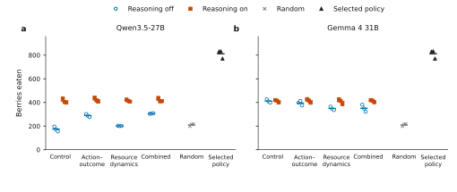
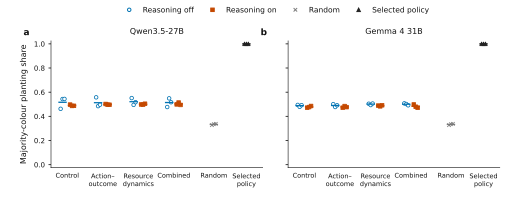
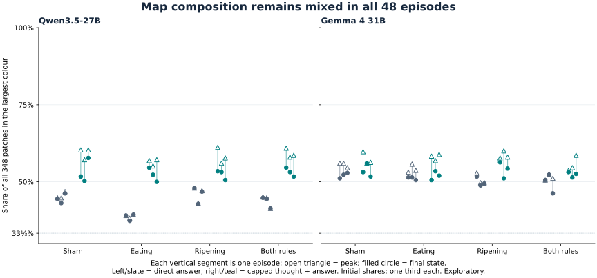

# v4 Block A results

The episode is the unit of inference. Each of the 16 model × information ×
reasoning cells contains three completed 1,500-frame episodes.

| Contrast on berries eaten | Qwen3.5-27B | Gemma 4 31B |
|---|---:|---:|
| Capped reasoning − direct answers | +174.3 | +35.2 |
| Both rules − sham | +69.7 | −29.8 |

The four pre-specified primary contrasts are corrected together. Capped reasoning
has Holm-adjusted Monte Carlo p-values of 0.0002 (Qwen) and 0.0045 (Gemma).
Both rules versus sham yields 0.0489 and 0.0792, respectively. In exact
enumeration the adjusted values for both-rules versus sham are 0.0500 and
0.0800. The pre-specified threshold is strictly below 0.05. Qwen also changes
sampling parameters across the reasoning arms.

Majority-colour planting is the pre-specified **secondary cooperation proxy**.
Its denominator is active planting attempts when the map has a unique
majority. Attempts count regardless of success. Across episodes, 99.68–100%
of attempts used the player’s own preferred colour. A roughly 50% majority
planting rate can therefore arise from the two groups planting their own colour.
The map’s largest colour reached at most 213 of 348 patches (61.2%), with final
shares ranging from 37.4% to 57.8%. Map reconstruction is exploratory.

[Action mix figure](figures/actions.svg) · [Paper draft](../docs/project-report-draft.md)

| Table | What it contains |
|---|---|
| [outcomes.csv](outcomes.csv) | One row per original episode, including harvest, welfare, Gini, actions and trace summaries |
| [cell_means.csv](cell_means.csv) | Descriptive means by treatment cell |
| [comparisons.csv](comparisons.csv) | Stratified tests and Holm correction for the four confirmatory primary contrasts |
| [original-verification.json](original-verification.json) | Original independent event recount and exact permutation sensitivity |
| [cooperation_episodes.csv](cooperation_episodes.csv) | Per-episode cooperation proxy and conditional planting counts |
| [cooperation_cell_means.csv](cooperation_cell_means.csv) | Cooperation summary by cell |
| [coordination_episodes.csv](coordination_episodes.csv) | Recolouring, own-colour planting and peak/final map composition |
| [coordination_cell_means.csv](coordination_cell_means.csv) | Composition summary by cell |
| [coordination_verification.json](coordination_verification.json) | Map-source hash and agreement with the 72,000 recorded pre-action majorities |
| [memory_reactions.csv](memory_reactions.csv) | Exploratory associations between recent visible events and actions |
| [screen/](screen/) | Historical fixed-state decisions summarized by prompt and wording |

The fixed-state screen tests sensitivity of individual decisions. It does not
estimate a treatment effect on full episodes. The endpoint figures include
the later descriptive random and selected-policy comparators. Their methods
are in the [baseline record](../docs/baselines.md).
